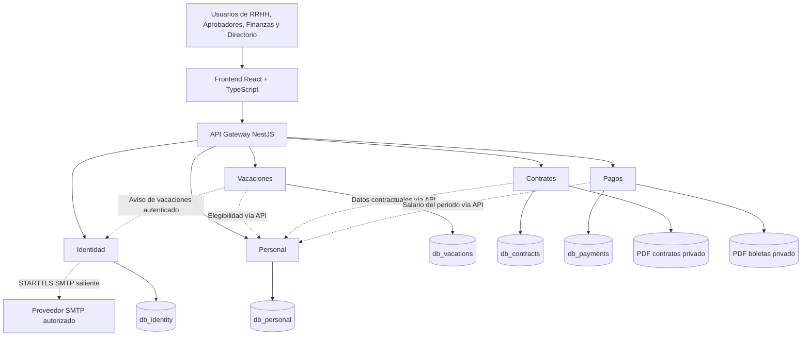

# ARCA RH — DOCUMENTO MAESTRO DE IMPLEMENTACIÓN PARA CODEX

**Versión consolidada:** 7.1 · **Fecha:** 1 de noviembre de 2026 · **Actualización:** correo transaccional SMTP real  
**Estado:** especificación técnica y funcional consolidada para implementación. **NO es evidencia de software construido, probado, aprobado legalmente ni desplegado.**  
**Entrega del kata:** 17 de noviembre de 2026.  
**Lema:** «Que sea funcional no lo hace usable».  
**Regla de producto:** **nada de flujos falsos, botones decorativos que aparentan funcionar, datos inventados en paneles, APIs fingidas o TODOs que sustituyan capacidades requeridas.** Implementar un sistema ejecutable con PostgreSQL real, APIs reales, controles de acceso efectivos, documentos persistentes y comprobaciones observables. Los *datos sintéticos* de prueba sí están permitidos y deben estar claramente separados de los datos operativos.

> **Para Codex:** Lee una vez las secciones 0–4 y 10–13 para establecer el contexto; consulta después las secciones concretas necesarias para cada tarea. No releas continuamente todo el documento. Registra avances resumidos en `docs/ESTADO.md`. La presente especificación consolida las versiones v1–v6; no debes tratar esas versiones como seis instrucciones independientes que compiten.

---

## 0. Jerarquía de autoridad y resolución de conflictos

1. **[KATA — OBLIGATORIO]** `KATA ARQUITECTÓNICO_TercerDesafio_2_2026.pdf`, pp. 1–2: cuatro módulos de negocio, arquitectura de microservicios, base relacional, presentación de impacto, documentación y cierre el 17/11/2026. El kata **no** obliga a cinco servicios, a React, a JWT, a determinada política legal, a una implementación bancaria ni a un número de pantallas.
2. **[PLAN — PROPUESTA DEL EQUIPO]** `ARCA_RH_Plan_Arquitectonico_27-10-2026.pdf`, pp. 1–9: cinco servicios, stack, contratos API iniciales, flujos y casos T01–T15. Las tablas allí listadas se proponen; no están ratificadas como esquemas intocables. Las ponderaciones 60/70/80/100 % se transcriben sin inventar su interpretación.
3. **[DISEÑO CONSOLIDADO — BASE OPERATIVA PARA CODEX]** este documento integra las propuestas de las seis revisiones: funcionalidad v1, huecos v2, seguridad v3, microservicios v4, visual v5 y pruebas v6. Dentro de su dominio, las soluciones más recientes y explícitas prevalecen sobre las preliminares: p. ej., **sesión opaca revocable en navegador + credenciales firmadas internas**, en lugar de dos sistemas de autenticación superpuestos.
4. **[DECISIÓN INSTITUCIONAL PENDIENTE]** reglas de negocio no presentes en el kata (cómputo de días, feriados, arrastre, rectificaciones, alcance real de permisos, etc.). **No presentarlas como normativa cierta**. Implementar desde el principio el mecanismo funcional de configuración/aprobación y sus validaciones. Una regla sin decisión no puede ejecutarse como oficial ni simularse silenciosamente.
5. **[EVIDENCIA REAL]** solo un comando ejecutado con salida observada, una prueba real o una revisión humana documentada permite afirmar que algo está implementado, funciona, está aprobado o es estable. Una captura, un mock, un test omitido o un diagrama no lo demuestran.

### Stack tecnológico explícito para Codex (decisión del proyecto)

- **Frontend:** React + TypeScript. Una sola aplicación web integrada, no microfrontends.
- **Backend:** NestJS + TypeScript sobre Node.js; API Gateway y cinco microservicios con procesos independientes.
- **Servidor HTTP de NestJS:** **Express**, usando **`@nestjs/platform-express` / `ExpressAdapter` explícito** para no depender de cambios de adaptador predeterminado entre versiones. **No construir otro servidor Express separado ni sustituir NestJS por Express puro.**
- **Persistencia:** PostgreSQL como base relacional; **Prisma ORM** con esquema, cliente y migraciones **propios por microservicio**.
- **Infraestructura:** Docker Compose con base de datos PostgreSQL interna, sin publicar el puerto 5432 del contenedor en Windows, donde PostgreSQL ya está instalado.
- **APIs:** REST/HTTP con contratos OpenAPI, validación de entrada y autorización en backend; sin broker de mensajería inicial.
- **Correo transaccional:** NestJS + Nodemailer vía SMTP autenticado (Gmail compatible con credenciales de aplicación donde estén habilitadas, u OAuth2 según proveedor), TLS obligatorio y credenciales exclusivas guardadas fuera de Git; sin microservicio de correo adicional.
- **Gestión de dependencias:** versiones compatibles fijadas y lockfile versionado; preferir lo imprescindible y no introducir otro ORM, backend, framework de frontend o servicio sin justificación aprobada.

**Esta especificación del stack es una decisión técnica para la implementación, no un requisito literal del enunciado académico.**

### Reconciliación expresa de contradicciones

| Tema | Decisión consolidada | Motivo |
|---|---|---|
| JWT del navegador vs sesión | Sesión **opaca revocable** en cookie segura; JWT **interno** firmado para servicios | Mantiene revocación e identidad interservicio sin dos esquemas web mezclados |
| «Configuración sin hardcoding» vs reglas seguras | Datos/catálogos/políticas aprobadas administrables; permisos y transiciones válidas implementados y probados en código | No construir editor libre de SQL, JS o reglas de seguridad |
| Cinco servicios vs microservicios obligatorios | Cinco dominios propuestos y un Gateway, por cohesión; sin más fragmentación | El kata exige microservicios, no un número específico |
| «Sistema real» vs «demo académica» | Implementación real con persistencia, seguridad y recuperación; **solo** los datos de ensayo pueden ser ficticios | Evita confundir prototipo con producto usable |
| PostgreSQL instalado vs contenedor PostgreSQL | **Un PostgreSQL canónico dentro de Compose para este proyecto**, sin publicar `5432` en host; instalación local queda separada | Evita conflictos con PostgreSQL ya instalado en Windows, permite arranque reproducible |
| Estado EMITIDO y PDF | `EMITIDO` solo tras confirmar la existencia, integridad y vinculación del archivo | Evita registros exitosos sin documento |
| Vacaciones 15 días vs calendario no definido | Derecho **15 días por gestión completada** (kata); metodología de conteo mediante política explícita elegida y aprobada | No inventar días hábiles, feriados, caducidad o arrastre |
| Política de pruebas «ahorrar tokens» vs seguridad | Verificación selectiva por impacto; pruebas obligatorias de riesgo y suite completa por hito | Ahorrar contexto sin ocultar regresiones |
| Prototipo HTML/capturas vs sistema final | Solo referencia de composición; desarrollar frontend funcional integrado a API y PostgreSQL | No entregar el prototipo como implementación |
| Correo opcional en borradores antiguos vs nuevo alcance | Implementar ahora SMTP real para recuperación de cuenta y avisos de vacaciones (con aprobación/cambio de estado); sin SMS, WhatsApp ni notificaciones masivas | Petición expresa del proyecto del 01/11/2026; no simular correo ni añadir un sexto servicio |

---

## 1. Alcance funcional: qué debe funcionar de verdad

### 1.1 Obligaciones del kata

**PERSONAL:** alta, modificación de área, cargo y remuneración; baja de funcionarios. Registrar historia y evitar eliminación destructiva de documentos anteriores.  
**VACACIONES:** un funcionario ratificado con al menos un año de antigüedad puede acceder a 15 días por gestión completada, conforme a las reglas de cómputo aprobadas. Debe existir flujo real de elegibilidad, solicitud, aprobación/rechazo, saldo, bloqueo de duplicados y auditoría.  
**CONTRATOS:** contrato básico parametrizable con ingreso, salario y tiempo de prueba; selección/versionado de plantilla, borrador, previsualización, emisión y descarga de PDF real.  
**BOLETAS / PAGOS:** registrar pagos y generar/almacenar boletas; partidas, importes precisos, estados y referencias evidenciables; no fingir transferencias bancarias ni liquidación fiscal automática.  
**ARQUITECTURA:** servicios desplegables independientes comunicados por API, base de datos relacional, UI convincente y documentación técnica verificable.

### 1.2 Criterio «real, no simulado»

- **Obligatorio:** cada botón habilitado tiene una acción efectiva (API real, datos persistidos, estado consultable, errores e idempotencia cuando aplica). Menús y tarjetas consultan datos autorizados existentes; no cifras estáticas ni éxitos generados solo en el navegador.
- **Obligatorio:** Docker Compose construye y levanta el frontend, Gateway, cinco servicios y PostgreSQL; existen migraciones reales, usuarios SQL independientes, almacenamiento PDF persistente, bootstrap seguro y respaldo/restauración ensayado.
- **Obligatorio:** formularios de usuarios, cargos, áreas, ratificación, contratos, vacaciones y boletas se operan desde la UI; no SQL como herramienta cotidiana.
- **Permitido:** fixtures y *seed* sintéticos etiquetados para pruebas y demostración; mocks **dentro de pruebas unitarias** para aislar lógica, siempre acompañados de integración real cuando se verifican BD, permisos y HTTP.
- **Prohibido:** servicios con respuesta JSON hardcodeada, `setTimeout` para fingir guardado, botones sin backend, PDF de ejemplo que no representa los datos, permisos solo visuales, tests que siempre devuelven OK, marcar completo un flujo incompleto, reemplazar errores con totales cero, un «ya lo implementaremos» para funcionalidad dentro de alcance.
- **Fuera del alcance (no son simulaciones pendientes):** conexión efectiva al Core externo sin contrato, firma electrónica legal, pagos bancarios, liquidación impositiva, biometría, app móvil, autoservicio de funcionarios, motor fiscal y canales de notificación **distintos del correo transaccional SMTP**. El correo SMTP para recuperación y estados de vacaciones **sí entra en alcance desde v7.1**; no crear falsos conectores.

### 1.3 Tipos de usuarios del plan

1. **Administrador RR. HH.:** funciones de personal, catálogos y operaciones RR. HH. explícitamente otorgadas. Administrar usuarios/roles es un privilegio separado; no implica acceso universal a pagos.
2. **Operador RR. HH.:** altas, búsquedas y modificaciones autorizadas, solicitudes y borradores; por defecto no administra roles ni aprueba solicitudes propias ni modifica salarios sin concesión especial.
3. **Aprobador de vacaciones:** bandeja, elegibilidad, saldo y decisión autorizada; no ve boletas ni sueldos individuales.
4. **Finanzas/Nómina:** periodos, conceptos, boletas, emisión, historial y registro de pago con evidencia; no modifica salarios maestros.
5. **Directorio:** indicadores agregados reales y consultas ejecutivas; salario individual, contrato y boleta ajenos no se muestran ni se devuelven en JSON salvo permiso específico aprobado.

**Una persona puede tener varios roles**, pero cada acción debe respetar permisos efectivos, alcance de recursos y campos. La matriz exacta requiere ratificación; en ausencia de concesión, **denegar**.

---

## 2. Recorridos completos y estados de negocio

### 2.1 Primera puesta en marcha y administración

1. `docker compose up --build` construye y levanta los procesos; inicialización controlada y repetible crea bases separadas y ejecuta migraciones sin borrar datos ya existentes.
2. Un comando/flujo **bootstrap de única ejecución** inicializa un administrador desde un secreto ingresado por canal seguro y nunca guardado en Git. No crear cuenta universal fija ni publicar su contraseña. Forzar cambio inicial cuando proceda.
3. El administrador entra con sesión segura y administra por UI usuarios, estado, asignaciones y catálogos. **La recuperación de contraseña por correo SMTP es una función obligatoria de esta versión:** enlace único, temporal y de un solo uso, dirigido a una dirección vinculada y verificada. No sustituirla por texto de éxito sin envío ni por un reset administrativo como única solución; si el SMTP no está configurado, señalar bloqueo de integración claramente, sin fingir funcionamiento.
4. Un panel de configuración inicial presenta **las políticas institucionales aún no registradas** antes de habilitar acciones dependientes. Las reglas ya definidas por kata aparecen identificadas y bloqueadas contra cambios indebidos. Guardar quién aprobó y desde cuándo aplica cada configuración.
5. Si una configuración imprescindible no existe, la operación afectada muestra «requiere configurar política X» con enlace para un administrador autorizado; nunca estima silenciosamente un resultado. **La pantalla y el mecanismo se construyen ahora**, no quedan como tarea de futuro.
6. Proteger la última cuenta administradora, registrar cambios de rol, revocar sesiones y verificar seguridad al volver a acceder.

### 2.2 Personal: alta, cambios, ratificación, baja

- **Alta:** seleccionar área/cargo activos desde catálogos, fechas, nombre, código de funcionario, documento cuando exista, remuneración y moneda. Validación de duplicados/IDs, formato y errores de campo. El código puede generarse siguiendo un patrón aprobado o ingresarse con validación; no inventar el patrón.
- **Confirmación:** persistir, auditar y mostrar ficha, identificador y siguientes acciones contextuales (contrato, vacaciones si aplica, historial), sin solicitar de nuevo datos existentes.
- **Cambios:** registrar antigua/nueva área/cargo/salario, actor, instante y **fecha efectiva**. Salario se gestiona con historial temporal; cambios retroactivos no alteran PDFs emitidos. La política de rectificaciones retroactivas debe estar explícitamente fijada.
- **Ratificación:** acción y fecha autorizadas, historia inmutable de la operación, no solo casilla editable; el significado institucional de ratificación lo configura/ratifica el dueño de negocio.
- **Baja lógica:** pedir fecha y motivo, confirmar consecuencias, conservar historial, contratos y boletas, impedir acciones posteriores inválidas y gestionar la relación con la cuenta de acceso cuando corresponda.
- **Excepciones:** cargo/área desactivado, registro duplicado, conflicto de edición concurrente con `version` o comprobación equivalente, salario con vigencias solapadas, reingreso pendiente de política y solicitudes de vacaciones abiertas. Nunca sobrescribir sin advertir.

### 2.3 Vacaciones: derecho, solicitud y aprobación

- Consultar a Personal empleado, ingreso, ratificación, condición laboral y versión/verificación de respuesta. No aceptar automáticamente un valor enviado por navegador como prueba de elegibilidad.
- Otorgar **15 días por gestión de antigüedad completada** según el kata; configurar explícitamente método de conteo (calendario/hábiles), calendario de feriados, aniversarios especiales, arrastre/caducidad y cualquier política variable. No asumir norma boliviana sin aval.
- El solicitante visualiza elegibilidad, saldo, fechas, días calculados, razones de inhabilitación y reglas aplicadas. No permitir saldos insuficientes, fechas inválidas o solapamientos prohibidos por la política aprobada.
- La solicitud queda `PENDIENTE` y aparece en bandeja del aprobador; se crea una notificación SMTP real al aprobador autorizado, si tiene email verificado, después de confirmar la transacción. La decisión revalida disponibilidad y estado; la **transacción en Vacaciones** garantiza saldo no negativo, una sola aprobación y movimientos coherentes incluso ante dos solicitudes simultáneas.
- `RECHAZADA` no consume días. Al aprobar o rechazar, enviar notificación SMTP real a la persona/usuario vinculado con dirección verificada, sin revelar salarios ni otros datos sensibles. Un error de correo no revierte una aprobación ya confirmada: registrar el envío pendiente o fallido y reintentar de forma controlada. La cancelación/reverso de `APROBADA`, reserva de saldo en pendientes y autogestión dependen de la política que se debe configurar/ratificar; no dejar botones falsamente activos.
- Mensajes de error explican si Personal no está disponible sin fabricar derechos. Historial y auditoría vinculados al empleado.

### 2.4 Contratos y documentos

- Elegir funcionario existente y plantilla activa versionada; precargar datos autorizados desde Personal, incluidas fechas y salario según vigencia aplicable. Introducir solo el tiempo de prueba y campos realmente requeridos que falten.
- Previsualizar variables resueltas, documento y versión; prohibir scripts, HTML activo, recursos externos y rutas locales arbitrarias. Mantener editor de variables permitidas, no constructor de código ejecutable.
- Guardar `BORRADOR`; al emitir, revalidar permisos y datos de Personal (incluidas versiones), solicitar confirmación ante cambios y pasar a `EMITIENDO`.
- Generar PDF real en directorio privado temporal, validarlo, moverlo a ubicación definitiva y finalizar el registro con metadatos, hash y snapshot. Solo comunicar `EMITIDO` si se comprobó su archivo asociado. Falla → `ERROR_EMISION` recuperable, sin duplicado en reintento.
- PDF emitido no cambia al modificar salario o plantilla. La rectificación/anulación se registra como nueva operación referenciada si existe política aprobada; no sobrescribir original. No atribuir al PDF firma o validación legal automática.

### 2.5 Boletas y registro de pagos

- Finanzas elige periodo y funcionario autorizado; Pagos consulta a Personal **compensación del periodo**, no simplemente el sueldo de hoy.
- Crear líneas de abonos/descuentos por conceptos administrables simples; realizar cálculo preciso **DECIMAL** en backend, neto no negativo, moneda explícita, periodo claro. No asumir impuestos/cotizaciones por nombre de concepto.
- Guardar `BORRADOR`, revisar y confirmar; pasar por `EMITIENDO` hasta `EMITIDO` tras guardar un PDF real, privado, verificable, snapshot y metadatos. Intentos repetidos no generan doble operación.
- **Emisión documental != movimiento de dinero.** Solo `record-payment` permitido para Finanzas autorizado con referencia/fecha/evidencia pasa a `PAGADO`. No declarar transferencias bancarias que no se hayan realizado.
- Consultar por periodo, empleado, estado; autorizar PDF individual. Definir duplicidad por periodo, complementos, ajustes, rectificaciones y reversos mediante política institucional antes de automatizar esas variantes.
- Fallo de Personal → no crear/emitir nuevos documentos dependientes; las boletas históricas siguen almacenadas y visibles para usuarios autenticados/autorizados.

### 2.6 Consultas ejecutivas

- Indicadores reales, agregados y autorizados de los cuatro dominios, con fechas/periodos y estados claros.
- Componer llamadas a los servicios desde la interfaz vía Gateway con paginación y controles; no SQL cruzado, no servicio BI adicional.
- Mostrar «Información no disponible» cuando una consulta falla, jamás un cero falso. No enviar remuneraciones individuales ocultas con CSS.

### 2.7 Reglas generales de flujo

**Cada tarea habilitada** debe tener: entrada natural → validación → acción → confirmación persistida → consulta/historial → manejo de errores/reintentos y, cuando corresponda, rectificación autorizada. Ficha de funcionario conserva contexto/ID al saltar entre módulos. Un usuario no debe acceder a SQL, paneles técnicos o archivos para completar operaciones cotidianas.

---

### 2.8 Correo transaccional SMTP — función real incorporada al alcance v7.1

**Objetivo:** añadir envío real de correo electrónico desde el backend para **recuperación segura de contraseña** y **notificaciones de solicitudes de vacaciones** (creación pendiente al aprobador y decisión aprobada/rechazada a la persona vinculada, cuando exista correo verificado y autorizado). No suponer autoservicio general del empleado: destinatarios efectivos se determinan según las cuentas y roles existentes. En ausencia de dirección verificada, registrar entrega pendiente/no realizable y mostrar una acción administrativa comprensible, sin inventar una dirección ni omitir silenciosamente el problema.

**Frontera y simplicidad:** no crear `email-service` como sexto microservicio, motor de campañas, sistema de SMS/WhatsApp ni plataforma de plantillas generalista. Implementar **módulo `Mail` dentro de Identidad** responsable de transporte SMTP, plantillas de seguridad y despacho limitado de avisos de negocio; Vacaciones únicamente registra y solicita sus eventos de notificación a Identidad por **API interna autenticada**, después de una transacción de negocio confirmada. Identidad conserva las direcciones de correo verificadas de cuentas; los servicios de negocio no reciben credenciales SMTP. No añadir lógica de email al API Gateway.

**Funcionalidades obligatorias:**

1. **Identidad:** email de cuenta único/normalizado cuando aplique, verificación del destinatario antes de usarlo para recuperar acceso; flujo «Olvidé mi contraseña» → solicitar enlace de recuperación → recibir correo real → abrir enlace HTTPS a ARCA RH → establecer contraseña nueva → invalidar token y sesiones afectadas. Token aleatorio criptográficamente fuerte, **hash almacenado**, caducidad corta, uso único, consumo atómico, límite de frecuencia y mensaje uniforme que no permita adivinar si existe la cuenta. El correo nunca contiene la contraseña ni secretos de autenticación permanentes.
2. **Vacaciones:** al crear una solicitud `PENDIENTE`, avisar a quienes estén explícitamente autorizados a aprobarla; al aprobar/rechazar, avisar al usuario vinculado cuando exista correo verificado. El mensaje debe tener asunto y texto claros, referencia de solicitud, estado y enlace interno al registro; **no incluir información salarial, PDF adjuntos, tokens de sesión ni datos personales innecesarios**. Los enlaces requieren login y permisos al abrirse; recibir el correo no concede acceso.
3. **Configuración y UI:** la administración autorizada de usuarios permite registrar y corregir direcciones; la pantalla de acceso incluye recuperación real; el sistema expone estado de correo **sin revelar secretos** en una pantalla/configuración técnica solo para administradores autorizados y permite comprobación de envío a una cuenta controlada. No permitir a cualquier usuario cambiar arbitrariamente remitente, servidor SMTP o destinatarios de notificaciones de otros usuarios.
4. **Entrega estable:** enviar correos de vacaciones después de confirmar su transacción. Registrar un evento de notificación pendiente en la **misma BD de Vacaciones** cuando el disparador deba sobrevivir a caídas; realizar entrega autenticada e idempotente a Identidad. Identidad guarda una **cola persistida mínima en su propia BD** y reintenta errores temporales con límites y demoras; marca `PENDIENTE`, `ACEPTADO_POR_SMTP` o `FALLIDO` sin duplicar el mismo evento por reintentos. No introducir Redis ni broker. La recuperación de contraseñas puede enviar inmediatamente con manejo explícito de fallos sin almacenar el token en claro en una cola o en logs.
5. **Integridad y UX:** error SMTP jamás debe convertir una operación de vacaciones exitosa en una operación «fallida» del negocio ni generar dos aprobaciones. Registrar y mostrar el problema de entrega en un lugar autorizado. No mostrar «correo enviado» cuando no existe confirmación SMTP; **aceptación por SMTP no equivale a entrega en bandeja de entrada**, por lo que la recepción real debe comprobarse en una cuenta controlada durante aceptación.

**Configuración local del proveedor, con valores de ejemplo y SIN credenciales reales:**

```dotenv
SMTP_HOST=smtp.gmail.com
SMTP_PORT=587
SMTP_SECURE=false
SMTP_REQUIRE_TLS=true
SMTP_USER=cuenta-exclusiva-del-sistema@gmail.com
SMTP_PASSWORD=                # Solo en archivo local secreto no versionado
SMTP_FROM=ARCA RH <cuenta-exclusiva-del-sistema@gmail.com>
APP_PUBLIC_URL=https://localhost    # Sustituir por origen HTTPS real probado
```

Para el puerto `587`, usar **STARTTLS obligatorio** (`secure=false`, `requireTLS=true`); para `465`, TLS desde el inicio (`secure=true`). TLS no debe degradarse silenciosamente a texto plano. Utilizar **Nodemailer** (`createTransport`, `verify`, `sendMail`) con *timeouts* y comprobación de errores; no bloquear solicitudes de negocio con reintentos prolongados. Gmail/Google Workspace admiten SMTP con OAuth2 y, según política de la cuenta, **contraseña de aplicación con verificación en dos pasos**. **Nunca usar la contraseña habitual de Google en el proyecto ni pedir que la compartan en el chat.** Si las contraseñas de aplicación no están disponibles, utilizar OAuth2 o un proveedor SMTP autorizado; el adaptador no cambia la arquitectura.

**Prueba final innegociable:** desde un entorno Docker real, probar autenticación SMTP y entrega efectiva a una casilla controlada, completar recuperación de contraseña abriendo el enlace recibido, verificar reuso/caducidad del enlace y comprobar aviso de solicitud/decisión de vacaciones. La verificación `transporter.verify()` por sí sola **no demuestra que un mensaje haya sido aceptado ni recibido**. Si aún no se proporcionaron credenciales SMTP locales, construir e integrar el flujo, pero registrar la prueba externa como **BLOQUEADA**, no APROBADA. No marcar el módulo como terminado hasta disponer de evidencia real.

**Fuentes técnicas adicionales (no requisitos del kata):** https://nodemailer.com/smtp ; https://developers.google.com/workspace/gmail/imap/imap-smtp ; https://support.google.com/mail/answer/185833 .

## 3. Matriz de responsabilidades, datos y dependencias

| Servicio | Es dueño de | Entidades relacionales candidatas | Interacciones externas |
|---|---|---|---|
| **Identidad** | Credenciales Argon2id, usuarios, sesiones revocables, roles, asignaciones, auditoría de acceso **y transporte SMTP transaccional seguro** | `users`, `roles`, `user_roles`, `sessions`, `login_audit`, `password_reset_tokens`, `mail_outbox` | Gateway y tokens firmados; API interna limitada de correo desde Vacaciones; nunca salarios |
| **Personal** | Empleados, áreas, cargos, ratificación, historial de estado y salario efectivo | `employees`, `departments`, `positions`, `salary_history`, `employment_events` | Consultas mínimas autenticadas de Vacaciones/Contratos/Pagos |
| **Vacaciones** | Derechos por gestión, movimientos, solicitudes, estados y aprobación atómica, **eventos de aviso de vacaciones** | `leave_entitlements`, `leave_requests`, `leave_movements`, `notification_events` y política/calendario si hacen falta | Lee elegibilidad desde Personal; solicita avisos de correo a Identidad con autenticación interna |
| **Contratos** | Plantillas versionadas, borradores, snapshots, estados, PDFs y referencias | `contract_templates`, `contracts`, `contract_documents` | Lee datos contractuales desde Personal |
| **Pagos** | Conceptos, partidas, periodos, boletas, evidencia de pago, PDFs, estados | `payment_records`, `payment_lines`, `pay_slips`, catálogo de conceptos si es necesario | Lee compensación desde Personal |

**Regla de propiedad:** cada microservicio tiene su base, usuario SQL, esquema Prisma y migraciones exclusivos. `employee_id` en otros servicios es una referencia lógica UUID, **sin FK SQL entre bases**; no copiar tabla maestra `employees` ni compartir modelos Prisma. Los snapshots documentales conservan datos usados en el momento de emisión y no constituyen otra fuente editable.

**Fechas:** laborales `DATE` (`YYYY-MM-DD`); auditoría `TIMESTAMPTZ` UTC, mostrado en zona local. Valores monetarios `DECIMAL`, no floats JS para sumas finales. Salario incluye vigencia temporal, registro/actor y conflicto de intervalos. Corregir diferencias de zona horaria y cómputo de aniversarios en tests.

### Comunicación



**API Gateway:** entrada, cookies/sesión, límites básicos, encaminamiento y cabeceras seguras; **sin reglas de vacaciones, salarios, pagos ni generación documental**. REST/HTTP síncrono con `timeout` corto explícito, `requestId`, errores normalizados, autorización por servicio y reintentos acotados únicamente donde son seguros. Sin broker, Kafka, RabbitMQ, Redis, Kubernetes, Sagas, servicio de auditoría, servicio de PDFs ni motor de workflows a priori. El correo SMTP transaccional se envía desde el módulo interno Mail de Identidad, sin sexto microservicio. Una operación que escribe en una sola base puede usar transacción local, no saga ficticia.

---

## 4. Contratos API: mínimo interoperable

**Convenciones comunes:** versión `/api/v1`, UUID, fechas ISO, importes como strings decimales en JSON, DTO allowlist, JSON de error `{code,message,requestId}`, estados HTTP 400/401/403/404/409/422/5xx coherentes, paginación y filtros limitados, OpenAPI por servicio. No exponer entidades ORM ni rutas internas por Gateway. Mantener contratos compatibles o versionar cambios incompatibles.

| Dominio | Endpoints externos funcionales mínimos (método y ruta bajo `/api/v1`) |
|---|---|
| Identidad | `POST /auth/login`; `POST /auth/logout`; `GET /auth/me`; `POST /auth/forgot-password`; `POST /auth/reset-password`; `POST /auth/verify-email` cuando corresponda; operaciones autorizadas `GET/POST/PATCH /users` y asignación/retirada de roles; recuperación **por SMTP real** |
| Personal | `GET/POST /employees`; `GET/PATCH /employees/{id}`; `POST /employees/{id}/termination`; `POST /employees/{id}/ratify`; consulta de historial; `GET/POST/PATCH` de áreas/cargos para roles autorizados |
| Vacaciones | `GET /vacations/balance/{employeeId}`; `GET/POST /vacations/requests`; `POST /vacations/requests/{id}/approve` y `/reject`; cancelar/revertir solo cuando la política institucional lo permita; consulta administrativa de política vigente |
| Contratos | `GET/POST/PATCH /contract-templates`; `GET/POST /contracts`; `POST /contracts/{id}/issue`; `GET /contracts/{id}/pdf` y detalle/historial; operación controlada de recuperación de emisión |
| Pagos | `GET/POST /payments`; `POST /payments/{id}/issue`; `POST /payments/{id}/record-payment`; `GET /payments/{id}/pdf`; consulta de estado y conceptos administrables |

**APIs internas autenticadas (no expuestas):** `POST /internal/mail/notifications` en Identidad **solo para servicios permitidos**, con `templateKey` limitado, `recipientUserId` validado e `idempotencyKey` por evento; `GET /internal/employees/{id}/eligibility`; `GET /internal/employees/{id}/contract-data`; `GET /internal/employees/{id}/compensation?period=AAAA-MM`. Respuesta mínima, versión/fecha de verificación cuando aplique. Cada consumidor tiene alcance técnico limitado y autorización de recurso en proveedor. No hacer llamadas SQL ni imports directos entre dominios.

**Versionado y concurrencia:** errores y rutas semánticos; precondiciones (`version`, `ETag/If-Match` o equivalente) en edición concurrente; `Idempotency-Key` o mecanismo persistente equivalente en aprobaciones/emisiones/registro de pago. Una UI que deshabilita un botón durante la petición **no** sustituye el control del backend.

---

## 5. Seguridad integrada y verificable

### 5.1 Modelo de amenazas mínimo

Activos: direcciones de correo verificadas, credenciales SMTP y tokens de recuperación, usuarios/credenciales/sesiones, datos identificativos y de ratificación, salarios y vigencias, derechos de vacaciones, contratos/plantillas, boletas/pagos, documentos privados, auditoría, volúmenes, backups y secretos. Amenazas STRIDE: suplantación, manipulación, repudio, fuga, denegación y elevación de privilegios. Fronteras: navegador↔Gateway, Gateway↔servicios, servicio↔propia BD, servicios↔Personal, generador↔PDF/volúmenes, backups/logs↔operadores.

### 5.2 Una solución coherente de sesión e identidad

1. Identidad almacena contraseñas con Argon2id y sesiones opacas revocables; el navegador utiliza cookie `HttpOnly`, `Secure` bajo HTTPS y `SameSite` apropiado; **ningún token en localStorage**.
2. En el entorno local HTTP, **no desactivar sin criterio `Secure` en producción**: ofrecer TLS local/terminación HTTPS para probar el flujo coherentemente; si se utiliza una excepción temporal de desarrollo, no afirmar que equivale a configuración segura pública.
3. El Gateway valida sesión con Identidad por solicitud protegida; si Identidad no responde, negar nuevas operaciones protegidas. Logout, bloqueo, baja y cambio de roles invalidan sesiones conforme a comportamiento verificable.
4. Identidad genera **aserción interna firmada de vida breve** con `iss`, `aud`, `sub`, `sid`, roles/contexto, `exp` y correlación; el Gateway no inventa identidad y cada servicio valida firma, audiencias, alcance y permisos por operación/registro/campo.
5. Para comunicación servicio-a-servicio, credenciales propias y tokens con audiencia/alcance específicos; no confiar en la red privada o encabezados falsificables. Clave privada de firma solo en Identidad; los verificadores obtienen clave pública; rotación documentada y prueba de fallo de token.
6. Protección CSRF para operaciones con cookie, controles de CORS/origen, rate limiting de login/reset, límites de entrada, política de contraseñas sólida sin reglas arbitrarias. Recuperación **SMTP real** con token aleatorio de un uso, hash persistido, caducidad corta, destinatario verificado, protección antienumeración y enlaces HTTPS controlados; ningún token/password en logs. La cuenta inicial se configura una sola vez por vía segura.
7. **La regla de autorización vive también en el servicio propietario**. `Gateway = primera barrera`, no única barrera. Por defecto denegar; no confiar en ocultar botones. Separar permisos de leer datos, cambiar salario, ratificar, aprobar, emitir, pagar y gestionar roles.

### 5.3 Controles de datos, documentos y operaciones

- Proteger IDOR/BOLA/BOPLA, mass assignment, SQLi/XSS, datos sensibles en JSON, historial, búsquedas y contadores. DTO de salida por permiso; campos no permitidos no viajan al cliente.
- No `PATCH` genérico capaz de poner `PAGADO`, `APROBADA`, `EMITIDO`, cambiar `role` o `salary` arbitrariamente; acciones de dominio controladas y auditadas.
- Las plantillas solo admiten marcadores autorizados y contenido tratado como datos. Generación PDF aislada sin scripts, cargas de archivos ni URLs externas; limitar tiempo, CPU, tamaño y rutas. PDF privado, hash, autorización en cada descarga, cabeceras seguras.
- Invariantes atómicas en dueño de la base; reintentos idempotentes y estados intermedios en PDFs. **Fallar cerrado** al no verificar identidad o datos obligatorios; no confundir degradación del dashboard con permiso de emitir usando valores obsoletos.
- Auditoría de usuarios/roles, cambios salariales, bajas, ratificaciones, aprobaciones, contratos, boletas y estados financieros. Registrar actor, timestamp, resultado, `requestId`; limitar acceso, evitar contraseñas/tokens/PDF/salarios en logs de aplicación.
- Credenciales SMTP exclusivamente en configuración local no versionada, accesibles solo a Identidad; TLS obligatorio, remitente permitido, plantillas acotadas, protecciones contra abuso/relay y registro de resultado de envío sin contenido sensible.
- Secretos fuera de Git, secretos separados por servicio, credenciales SQL mínimas, contenedores no root, no montajes `docker.sock`, locks de dependencias, `npm ci` y verificación de vulnerabilidades razonable. Backups protegidos y restauración probada de **BD + PDFs**.
- Las configuraciones de despliegue local no equivalen automáticamente a certificación, alta disponibilidad ni producción segura. No cargar información real de funcionarios sin autorización y evaluación de privacidad/infraestructura.

### 5.4 Matriz inicial de permisos (propuesta conservadora)

| Acción | Admin RRHH | Operador RRHH | Aprobador | Finanzas | Directorio |
|---|---|---|---|---|---|
| Registrar/editar funcionario | Sí según permiso | Sí según permiso | No | No | No |
| Cambiar remuneración individual | Privilegio adicional | No por defecto | No | No | No |
| Ratificar funcionario | Permiso explícito | Según política | No | No | No |
| Crear solicitud de vacaciones | Sí | Sí según permiso | Según política | No | No |
| Aprobar/rechazar solicitud | No por defecto | No | Sí, ámbito permitido | No | No |
| Emitir contrato | Sí si autorizado | Según permiso | No | No | No |
| Preparar/emitir boleta | No | No | No | Sí | No |
| Registrar pago con evidencia | No | No | No | Sí según permiso | No |
| Ver salario individual | Solo ámbito permitido | Restringido | No | Necesario para boleta | No por defecto |
| Ver indicadores agregados | Sí | Solo relevantes | Solo pertinentes | Solo Finanzas | Sí |
| Administrar usuarios/roles | Solo identidad-administrador designado | No | No | No | No |

**No considerar esta matriz política oficial aprobada.** Es un valor inicial conservador para minimizar privilegios; permitir asignaciones desde la UI de **permisos estables definidos en código** cuando el equipo ratifique su alcance. No crear un editor arbitrario de predicados de autorización.

---

## 6. Datos, transacciones, resiliencia y reglas operativas

- **Bases:** `db_identity`, `db_personal`, `db_vacations`, `db_contracts`, `db_payments` en una instancia PostgreSQL de Compose. Cada servicio opera con usuario SQL distinto y permisos solo sobre su BD. Migraciones Prisma propias. Restricciones de integridad comprobadas con PostgreSQL real.
- **Cambios temporales:** historial salarial con `vigente_desde`, `vigente_hasta` si aplica, monto, moneda, actor y registro; sin dos fuentes de verdad contradictorias. Tratar periodos y cambios retroactivos explícitamente.
- **Documentos:** almacenamiento persistente privado por dominio, índices sobre empleado/periodo/estado; hash del archivo y versión de snapshot; descarga autorizada. Reconciliar archivos huérfanos/errores sin declarar emisión falsa.
- **Vacaciones:** lock transaccional/concurrencia apropiada, movimientos de derecho y consumo, sin saldo negativo. Repetir operación no descuenta dos veces. Políticas versionadas si afectan cálculos históricos.
- **Pagos:** un mismo intento idempotente no puede marcar dos veces la misma operación. La unicidad empleado-periodo requiere definir si existen complementos/ajustes; no imponer restricción sin validarla.
- **Timeout/reintento:** timeout interno con error legible; GET reintentable de modo acotado; POST no reintentable indiscriminadamente. Correlación por ID; no duplicar múltiples capas de retry.
- **Seguridad operacional:** healthchecks ≠ tests; logs breves sin datos sensibles; proteger backups y restaurar escenario real sobre datos sintéticos. Evitar dependencias circulares y N+1 HTTP en listados.
- **No prometer atomicidad interservicio** al consultar Personal antes de grabar en Pagos/Contratos; conservar versión/verificación de datos y revalidar antes de emitir. Una escritura distribuida nueva requeriría decisión de arquitectura, no magia transaccional.

---

## 7. Experiencia visual y diseño de pantallas

### 7.1 Sistema de diseño

Estética **Enterprise Calm** propuesta: jerarquía legible, espacios generosos, una acción primaria, información de negocio destacada, tablas profesionales, tonos corporativos sobrios, sin animaciones distractoras. **No** representar estos colores como identidad ARCA aprobada.

```css
:root {
  --brand-navy: #142B46;
  --brand-blue: #22577A;
  --brand-teal: #0E756D;
  --bg: #F4F7FA;
  --surface: #FFFFFF;
  --ink: #1D2B3A;
  --muted: #536578;
  --border: #DCE5EE;
  --success: #176547;
  --warning: #8C5C13;
  --danger: #A43142;
  --radius-card: 14px;
  --radius-input: 9px;
  --space-1: 4px;
  --space-2: 8px;
  --space-3: 12px;
  --space-4: 16px;
  --space-6: 24px;
  --space-8: 32px;
}
```

Inter o fuente de sistema; iconos lineales coherentes. Espaciado base 4/8/12/16/24/32/48 px; títulos de página ~26–30px, subtítulos 18–20px, cuerpo 14–16px; botones/controles típicamente 40–44px, foco visible, contraste medido. Las cifras son **propuestas a validar**, no requisitos del kata.

### 7.2 Disposición y navegación

- **Escritorio (referencia 1440 px):** menú lateral ~240px, cabecera 68–72px, contenido de ancho cómodo 1120–1240px con relleno 24–32px. Responsive a tablet y móvil; menú drawer en móvil, tablas adaptadas sin ocultar acciones importantes en scroll críptico.
- Menú por rol: **Inicio, Personal, Vacaciones, Contratos, Boletas y pagos, Administración** según privilegios. Navegación contextual desde ficha: resumen, historial, vacaciones, contratos, boletas, solo para autorizados.
- Cabecera con marca, contexto, título, perfil y cierre de sesión. Una acción primaria visible por pantalla; filtros cerca de tabla, estados y errores cerca de la tarea.
- Formularios preferiblemente de una columna, agrupados por significado, ancho cómodo ~640–760px; pocas columnas solo para campos estrechamente relacionados; etiquetas permanentes, select para catálogos, ayuda inmediata, fechas/moneda claras, sin borrado accidental del formulario.
- Tablas con búsqueda nombre/código, filtros por área/estado/periodo, paginación backend, acción «Ver ficha»/editar autorizada. No construir Excel dentro del navegador ni exportaciones masivas innecesarias.
- Confirmaciones reales con identificador y siguiente paso. Errores de campo legibles, pantallas vacías útiles, estado pendiente, error de permisos y servicio caído distinguidos de «cero resultados». WCAG 2.2 AA como **objetivo técnico voluntario**, no afirmación de obligación legal.

### 7.3 Plantillas de pantalla obligatorias como experiencia (no 12 microfrontends)

| ID | Pantalla | Objetivo y elementos |
|---|---|---|
| UI-01 | Acceso | Usuario/contraseña, mostrar/ocultar, **recuperación por enlace SMTP real**, error genérico seguro, sesión |
| UI-02 | Inicio por rol | 2–4 indicadores relevantes y tareas pendientes **reales**, atajos contextuales |
| UI-03 | Personal: listado | Búsqueda, filtros, paginación, registrar, acceso a ficha |
| UI-04 | Personal: ficha | Datos e historial autorizados, acciones contextuales interdominio |
| UI-05 | Personal: formulario | Campos agrupados, área/cargo como catálogos, validación y guardado real |
| UI-06 | Vacaciones: bandeja | Solicitudes pendientes y estados, filtros, acceso a revisión |
| UI-07 | Vacaciones: solicitud/revisión | Elegibilidad, saldo, fechas y política aplicada, aprobar/rechazar con confirmación |
| UI-08 | Contratos | Listado, plantilla, editor restringido, borrador, vista previa, emisión y PDF |
| UI-09 | Boletas/pagos | Periodo, líneas, importes, estados, revisión, PDF y registro posterior de pago |
| UI-10 | Administración: usuarios | Cuentas, roles autorizados, estado, bloqueo/revocación |
| UI-11 | Administración: catálogos | Áreas, cargos, conceptos y plantillas de su dominio, conservando historia |
| UI-12 | Estados | Cargando, sin datos, sin permiso, error, conflicto, éxito, dependencia caída, reintentar |

**Componentes visuales reutilizables, no obligación de carpetas por componente:** `AppShell`, `PageHeader`, `DataTable`, `SearchFilters`, `StatusBadge`, `Field`, `FormSection`, `ConfirmationDialog`, `InlineAlert`, `EmptyState`, `DetailSummary`, `DocumentPreview`, `ActivityTimeline`, `Pagination`, `LoadingSkeleton`. La complejidad debe vivir dentro de módulos coherentes; reutilizar bibliotecas accesibles existentes cuando aporten valor.

### 7.4 Prueba de usabilidad real

Probar con una persona que no programó el sistema: alta → contrato, vacaciones → aprobación, boleta → pago registrado, Directorio → indicador. Registrar éxito, errores, ayudas necesarias y confusiones. Una captura bonita no acredita usabilidad. Los prototipos HTML/PNG anteriores son **referencias no funcionales** y **no** son criterio suficiente para cerrar ningún módulo.

---

## 8. Estrategia de pruebas por impacto para ahorrar tokens

**Objetivo:** el conjunto más pequeño que cubra con evidencia los riesgos de un cambio, ampliando para seguridad, contratos, integridad, migraciones y cierre de hitos. No ejecutar todas las pruebas después de cada archivo, **pero nunca reducir controles críticos para ahorrar contexto**.

| Nivel | Momento o tipo de cambio | Verificaciones |
|---|---|---|
| **N0** | Solo documentación/diagramas, sin código ni contratos generados | Inspección de diff, formato/enlaces si aplica; no suite funcional |
| **N1** | Cambio local durante programación | Unitarias/componente/validaciones focalizadas y typecheck/lint pertinente |
| **N2** | Cierre de funcionalidad | Unitarias e integración del paquete/servicio afectado, negativos y persistencia si aplica |
| **N3** | Contrato HTTP, seguridad, migración, consumidor o flujo interservicio | Tests de contrato/API, autenticación, integración real y E2E focalizado |
| **N4** | Cierre de sprint, entrega, cambio transversal desconocido | Batería del sistema construido: servicios, permisos, E2E críticos, Compose, persistencia y restauración |

**Clasificador obligatorio:** `git diff` → archivos afectados → imports/rutas/API/consumidores reales → riesgo (bajo/medio/alto/transversal) → pruebas mínimas suficientes → evidencia de selección. No inferir impacto solo del nombre del archivo; un cambio de una línea en autorización puede ser crítico.

| Cambio | Selección mínima inteligente |
|---|---|
| CSS/iconos/espacios | Comprobación visual focalizada y estáticos; tests de interacción si afectan usabilidad |
| Formulario de personal | Componentes/validaciones + integración de alta/edición si cambió la petición o el guardado |
| Salario vigente o retroactivo | Fechas efectivas, DB real, contrato API con Pagos y snapshot si cambió su consulta |
| Vacaciones, elegibilidad | Casos límite de ratificación/aniversario/saldo |
| Vacaciones, aprobación | Transacción PostgreSQL real, doble aprobación, saldo, permisos e idempotencia |
| Contratos/PDF | Variables, seguridad de plantilla, archivo PDF real, snapshot, hash, error intermedio/reintento |
| Pagos/boletas | Decimales, estados EMITIDA/PAGADA, permiso, PDF, persistencia y reintentos |
| Identidad/Gateway | Sesiones, revocación, CSRF, roles, falsificación interna, protección de campos y rutas |
| Prisma/migraciones | Migración en BD de prueba, restricciones y consultas; no migración destructiva en datos valiosos |
| Compose/infraestructura | Build, arranque, healthchecks, conexiones reales, puertos privados y recuperación |
| Contratos compartidos/lockfiles | Consumidores directos/indirectos, builds de paquetes, dependencias y seguridad; ampliar si impacto incierto |

**Ahorro concreto de tokens:** ejecutar una vez y no dejar watchers; salida breve de test exitoso; log extenso a archivo privado y leer solo el fallo. No releer logs completos; no reejecutar prueba exitosa sin cambio relevante en código/configuración/dependencias/entorno. Ante falla, aislar, reparar, probar focalizado y luego repetir la batería obligatoria antes de declarar cierre. Nunca usar `|| true`, `.skip`/`--passWithNoTests` para ocultar carencias, ni inventar los nombres de scripts antes de inspeccionar `package.json`.

**Recorridos E2E clave:** (1) alta/cambio/historial; (2) vacaciones/aprobación/saldo; (3) plantilla→contrato→PDF; (4) periodo→boleta→PDF→PAGADO con evidencia; (5) acceso indebido denegado por backend; (6) reinicio/persistencia/servicio caído. Los casos límite profundos se prueban preferentemente en integración y unitarias, no multiplicando decenas de E2E redundantes.

---

## 9. Infraestructura existente y despliegue real

### 9.1 Información de entorno proporcionada

- **Sistema del usuario:** Windows; Docker ya instalado; PostgreSQL instalado localmente con directorios por defecto, locale predeterminada y puerto **5432**. **La existencia o salud efectiva de los servicios no ha sido comprobada en esta conversación.**
- **Credencial administrativa local de PostgreSQL:** fue compartida en el chat, **pero no se reproduce, copia ni utiliza desde este documento**. Al haberse compartido, se recomienda **rotarla antes de utilizar esa instalación para datos sensibles**. Nunca incluir contraseñas, tokens, JWT, claves o cadenas de conexión completas en repositorio, documentación, commits, salida de tests o logs.
- **Decisión canónica:** para ejecutar ARCA RH **usar PostgreSQL administrado por Docker Compose**, conectado únicamente mediante la red privada de Compose. No publicar `ports: ["5432:5432"]`, pues chocaría con el servicio PostgreSQL del host. La base local preexistente se mantiene intacta y **no es la base operativa de ARCA RH**. Así no hace falta reutilizar la contraseña local ni reconfigurar `pg_hba.conf`, firewall o `host.docker.internal`.
- Las credenciales de `postgres` de Compose y las cinco cuentas SQL serán secretas, únicas, suministradas por archivos/variables locales **ignorados por Git**, a crear con procedimiento documentado y validado; ejemplo de configuración únicamente con nombres de variables, nunca valores reales. Mantener env.example sin secretos válidos.

### 9.2 Topología local reproducible

Contenedores previstos: `web`, `gateway`, `identity`, `personnel`, `vacation`, `contract`, `payment`, `postgres` (**8 procesos/servicios Compose**). El frontend y API se exponen preferentemente bajo **un único origen local**, a través de un proxy ligero o la opción de enrutamiento ya elegida; no publicar directamente cinco APIs de dominio. Un proxy **no es otro microservicio**.

Volúmenes persistentes: PostgreSQL + PDFs privados de Contratos + PDFs privados de Pagos (+ almacenamiento mínimo de backup según procedimientos). `postgres` escucha en 5432 **dentro de la red**; Windows conserva su PostgreSQL local en 5432 sin conflicto. El acceso para comprobaciones administrativas de la BD contenedorizada se realiza mediante `docker compose exec`, sin abrir un puerto permanente al host.

**Secuencia operativa comprobable, no solo instrucciones teóricas:**

1. Verificar comandos realmente instalados: Docker, Compose, Git, Node solo si se necesitan para desarrollo fuera de contenedor, `docker info` y disponibilidad de recursos. No asumir que «instalado» equivale a «funcionando».
2. Crear/validar archivos de secretos locales no versionados; preparar red privada y volúmenes; levantar PostgreSQL y comprobar `pg_isready`.
3. Inicializar de manera idempotente cinco bases y cinco usuarios SQL restringidos; migraciones Prisma automáticas **controladas** en entorno nuevo, no aplicar migraciones destructivas sin revisión. Verificar aislamiento real probando denegación de acceso cruzado.
4. Levantar Identidad, Gateway y servicios con healthchecks efectivos; bootstrap de admin por secret seguro, no una contraseña pública fija. Compilar frontend y atender peticiones reales.
5. Ejecutar pruebas de punta a punta con datos sintéticos; reiniciar contenedores comprobando persistencia real; restaurar respaldo BD+PDF en **entorno de prueba aislado** y verificar integridad.
6. Documentar comandos existentes y probados en README y scripts concretos (`package.json`, Makefile o scripts si realmente aportan), mensajes de falla y recuperación; no prometer un `docker compose up` que nadie probó.

**Exposición:** preferir HTTPS incluso local para evaluar cookies seguras; si alguna decisión de desarrollo exige HTTP temporal, marcar limitación y probar configuración correcta con HTTPS antes de entrega. Contenedores no privilegiados, dependencias fijadas y puertos internos privados. **Compose y healthchecks no garantizan alta disponibilidad ni seguridad de producción pública.**

### 9.2.1 Integración con el SMTP real (no incorporar servidor de correo ficticio al producto)

- El contenedor `identity-service` recibe de forma segura `SMTP_HOST`, `SMTP_PORT`, `SMTP_SECURE`, `SMTP_REQUIRE_TLS`, `SMTP_USER`, `SMTP_PASSWORD`, `SMTP_FROM` y `APP_PUBLIC_URL`. Solo esa aplicación conoce el secreto del transporte.
- La salida desde Docker a `smtp.gmail.com:587` debe poder resolver DNS y establecer STARTTLS; ejecutar `verify()` y después envío real a casilla controlada. La recepción final se constata fuera de la aplicación.
- Mantener `.env.example` con **marcadores vacíos** y `.env`/secretos excluidos del repositorio, de imágenes y de logs; README explica dónde configurar las credenciales en el equipo del usuario. No inventar credenciales y no abrir un servidor SMTP local como sustituto de Gmail.
- Probar que fallos de DNS, credenciales inválidas, TLS, cuota/limitación, destinatario no verificado y respuesta temporal producen estados recuperables, mensajes correctos y no alteran aprobaciones ni contraseñas existentes.

### 9.3 Desarrollo y respaldos

- Repositorio Git con `.gitignore` de `.env`, secretos, bases, volúmenes y artefactos sensibles. Commits frecuentes por hitos con posibilidad de revertir; no borrar trabajo existente.
- Las migraciones no se ejecutan manualmente por usuarios operativos; herramientas de arranque las gestionan de forma reproducible.
- `npm ci`/lockfile, build por imagen y pruebas no interactivas. No instalar dependencias innecesarias; no subir snapshots con datos reales.
- Los datos sintéticos solo sirven como **entradas de prueba**, procesadas por la misma lógica de negocio que los datos legítimos. En el producto los indicadores, operaciones y PDFs siempre se calculan desde registros persistentes.

---

## 10. Trabajo de Codex y control de autonomía

### 10.1 Reglas permanentes de Codex

1. Inspeccionar primero el repositorio, `git status`, versiones, archivos y estado real. No sobrescribir implementación preexistente.
2. Leer el presente archivo como **referencia única** y solo consultar el PDF obligatorio o el plan original cuando exista discrepancia verificable. Nunca convertir propuestas en obligaciones del docente por suposición.
3. Implementar **verticales completas** (UI → Gateway → servicio → BD → estado/persistencia → autorización → error/reintento → pruebas), no carpetas vacías o fachadas que respondan OK.
4. No gastar tokens en rediseñar de nuevo una arquitectura aprobada, generar múltiples planes paralelos ni releer continuamente los ocho documentos.
5. Usar pocos agentes y paralelismo solo en trabajo sin solapamiento de archivos; integrar y validar contratos centralizadamente.
6. Minimizar infraestructura y abstracciones; 5 servicios amplios, un Gateway, una web. Evitar CRUDs genéricos que permitan saltar transiciones. No construir funciones superfluas.
7. Las decisiones de negocio institucionales no inventadas se registran en una tabla compacta `docs/DECISIONES.md` con responsable, alternativa y aprobación. Construir **ahora** el mecanismo real de configuración y validación del flujo que dependa de esas decisiones; no camuflar reglas desconocidas mediante valores hardcodeados.
8. Cuando una decisión específica impida un resultado correcto, **avanzar con trabajo independiente autorizado** y declarar el bloqueo de negocio explícitamente. No reportar el flujo bloqueado como terminado; no dejar una implementación fingida. El objetivo del desarrollo es completar todas las capacidades **dentro de alcance** con la política aprobada para su uso.
9. Antes de ejecutar tests, aplicar sección 8 (impacto). No ejecutar N4 después de cada archivo. No ahorrar pruebas de permisos, dinero, vacaciones, PDFs, migraciones o contratos.
10. Mantener `docs/ESTADO.md` breve al cierre de hitos: completado con evidencia, fallos, riesgos, próxima tarea. Informe de respuesta compacto: cambios, pruebas, problemas reales.
11. No ejecutar comandos destructivos en bases locales existentes, no tocar credenciales del host y no desplegar a internet o producción sin autorización. No modificar secretos ni mostrar su contenido en chat.
12. Usar datos sintéticos en pruebas; un usuario real opera la app por UI sin SQL. No inventar cifras de dashboard ni simular endpoints.

### 10.2 Secuencia de entrega por hitos reales

- **Hito 0, infraestructura reproducible:** monorepo, Docker, bases restringidas, migraciones, CI básica, `README`, contrato de identidad y punto de inicio seguro. Salida: servicio verdaderamente arrancable y conexiones probadas.
- **Hito 1, Identidad + Personal + SMTP:** login, roles, altas/ediciones/bajas, ratificación, áreas/cargos, salarios con historia y UI completa. **Recuperación real de contraseña por enlace SMTP**, verificación de destinatario y tests de caducidad/reutilización; integración externa marcada BLOQUEADA hasta probar credenciales locales y recepción real. Seguridad y pruebas de esos flujos.
- **Hito 2, Vacaciones + Contratos:** políticas aprobadas/configuradas, solicitudes/aprobaciones consistentes, **notificaciones SMTP reales y recuperables en solicitudes y decisiones**, plantillas, PDF real y estados de emisión recuperables; pruebas de concurrencia, integridad, permisos y correo.
- **Hito 3, Pagos + integración visual:** importes/periodos/PDF/registro de pago, dashboards con datos reales, rutas por rol y correcciones UX. E2E integrados, restore/backup, documentación C4/ADR y demostración.

**El hito no está terminado porque compile.** Deben estar conectadas las capas, persistir la información, funcionar la autorización, pasar las pruebas pertinentes y existir evidencia. El calendario tentativo del plan (03/11 y 10/11) no desplaza la fecha oficial **17/11/2026**.

### 10.3 Estructura esperada del monorepo (guía, no mandato de crear capas vacías)

```text
arca-rh/
  ARCA_RH_MASTER.md          # Esta única especificación
  AGENTS.md                  # Instrucciones breves que apuntan al MASTER
  apps/
    web/
    api-gateway/
    identity-service/
    personnel-service/
    vacation-service/
    contract-service/
    payment-service/
  packages/
    api-contracts/           # DTO/OpenAPI públicos; NUNCA entidades Prisma compartidas
  infra/
    compose.yaml
    postgres-init/
  docs/
    ESTADO.md
    DECISIONES.md
    adr/
    c4/
  tests/
    contracts/
    e2e/
```

Dentro de cada servicio: controlador HTTP, lógica de negocio en clases/módulos coherentes, validaciones y Prisma propio. No imponer carpetas `ports/adapters/repositories/use-cases/factories` para CRUD trivial. Solo abstraer donde una frontera real reduce complejidad.

---

## 11. Decisiones abiertas con cierre operativo sin «lo hacemos después»

**Estas preguntas no son defectos a inventar ni justificación para mostrar pantallas falsas.** Son decisiones que un responsable institucional debe aprobar. El sistema incluirá desde esta versión una UI mínima de parámetros aprobables y su verificación por backend **cuando sean realmente configurables**, sin convertir políticas legales en un motor libre de reglas.

| ID | Decisión requerida | Camino de cierre real en el sistema |
|---|---|---|
| D01 | Significado/fecha/autoridad de ratificación | Acción autorizada y auditada; criterios ratificados en configuración y pruebas |
| D02 | Días calendario o hábiles, feriados, 29 de febrero | Parámetros/calendario administrables según política autorizada; no calcular oficialmente sin seleccionar política |
| D03 | Arrastre/caducidad y orden de consumo por gestión | Política versionada y movimientos consistentes; no caducidad inventada |
| D04 | Reservar saldo en pendientes, solapamientos, cancelación tras aprobar | Transiciones y comprobaciones definidas antes de habilitar decisión correspondiente |
| D05 | Autoridad y fecha efectiva de cambios salariales/retroactivos | Permiso especial, vigencias sin solapamiento y trazabilidad; no alterar PDFs históricos |
| D06 | Una o varias boletas por empleado/periodo | Regla aprobada de duplicación/complementos; idempotencia del mismo intento siempre obligatoria |
| D07 | Rectificaciones y reversos de documentos/pagos | Rectificación referenciada con autorización; sin sobrescritura de emitidos |
| D08 | Formato institucional de contratos y periodo de prueba | Plantillas versionadas y campos/periodo configurados por autoridad; no proclamar validez jurídica |
| D09 | Ámbito exacto de cada rol y autogestión/autoaprobación | Matriz de permisos por acción/objeto y denegación por defecto |
| D10 | Código de funcionario, moneda, reingreso, retención documental | Catálogos/configuración según pertinencia; nunca patrones arbitrarios invisibles |

**No crear configuraciones de más:** el dato fijo expresamente exigido por el kata (15 días por gestión completada) se mantiene como regla de alcance y se verifica; se parametriza su método de cómputo según política autorizada, no se invita al usuario a reprogramar por SQL o JavaScript.

**Durante pruebas:** el responsable de pruebas puede cargar políticas **de ensayo explícitas**, con indicadores de entorno de ensayo, y validar flujos de principio a fin. **No vender esos valores como política laboral institucional ni utilizar registros de prueba para afirmar que una aprobación humana ya ocurrió.**

---

## 12. Definition of Done — criterios de aceptación obligatorios

Una funcionalidad del kata es **TERMINADA** únicamente cuando todos los apartados pertinentes están demostrados:

- [ ] Desde un rol autorizado se completa el flujo real **por UI**, sin SQL ni editar configuraciones manualmente; las llamadas viajan por Gateway a un microservicio real.
- [ ] Los datos se guardan en PostgreSQL del dueño y se recuperan tras reiniciar procesos; PDFs reales almacenados fuera de web pública.
- [ ] Validaciones de cliente y backend, estados/historia, concurrencia/idempotencia y transiciones sensibles se comprueban cuando afectan ese flujo.
- [ ] Un usuario sin autorización no accede por UI **ni por API directa**, con chequeos de acción, objeto y propiedad/atributo sensible.
- [ ] En fallo de dependencia, error de archivo, duplicado o pérdida de conexión, no se miente sobre éxito, no se corrompen datos y existe recuperación segura.
- [ ] Se ejecutó y documentó el subconjunto de pruebas seleccionado por impacto, incluyendo negativas/DB real cuando corresponden; suites fallidas no se ocultan.
- [ ] La navegación es usable para el perfil de destino, conserva contexto, muestra mensajes y no usa placeholders decorativos.
- [ ] Si una operación requiere email, su entrega se realiza por **SMTP real** y se comprueba aceptación por el servidor y recepción en un buzón controlado; los errores/reintentos quedan registrados sin fingir éxito. Recuperación mediante token de un uso probada; sin enviar secretos ni datos sensibles por correo.
- [ ] Logs sin credenciales; secretos fuera de Git; contratos API/DDL/versiones coherentes; no tablas compartidas entre servicios.
- [ ] README y procedimiento de ejecución **han sido probados**; configuración necesaria está disponible mediante mecanismo seguro. Ningún TODO bloqueante en una capacidad requerida.
- [ ] Al cerrar sprint: N4 con evidencia sobre todo el sistema construido. Antes de la entrega: arranque completo, prueba de persistencia y restore de base+PDF en entorno aislado, seguridad de roles y recorrido demostrable.

### Demo final obligatoria, ejecutada sobre operaciones reales

1. Iniciar sesión; Inicio muestra cifras reales del entorno de pruebas.
2. Crear funcionario sintético en Personal y visualizar su ficha.
3. Cambiar remuneración con fecha efectiva; verificar historial.
4. Solicitar vacaciones de trabajador ratificado y elegible, aprobar y comprobar saldo; rechazar solicitud inválida.
5. Elegir plantilla, emitir y descargar contrato PDF verificado.
6. Preparar boleta con conceptos, emitir PDF; registrar pago con fecha/referencia y distinguir `EMITIDO` de `PAGADO`.
7. Solicitar recuperación de contraseña, recibir el email SMTP real en casilla controlada, seguir el enlace y establecer nueva contraseña; validar que el enlace no se reutiliza. Verificar recepción real de aviso de vacaciones pendiente y aprobada/rechazada.
8. Repetir con rol sin permisos y demostrar 403/404 sin filtración de datos; reiniciar y verificar persistencia.

El objetivo es **operación de software real con datos sintéticos**, no presentación de funciones simuladas. No prometer estabilidad perfecta por adelantado: medir errores, ejecutar pruebas y corregir hasta alcanzar los criterios aprobados.

---

## 13. Bibliografía y fundamentos de diseño (referencias de origen)

**Arquitectura:** Sam Newman, *Building Microservices* (2.ª ed.); Vaughn Vernon, *Implementing Domain-Driven Design*; Chris Richardson, *Microservices Patterns*; Martin Kleppmann y Chris Riccomini, *Designing Data-Intensive Applications* (2.ª ed.); John Ousterhout, *A Philosophy of Software Design*; Microsoft Azure Architecture Center (Microservices Architecture, Data Considerations).  
**UX:** Steve Krug, *Don't Make Me Think, Revisited*; Don Norman, *The Design of Everyday Things*; Jenifer Tidwell et al., *Designing Interfaces* (3.ª ed.); Jon Yablonski, *Laws of UX*; Nielsen Norman Group; GOV.UK Design System; IBM Carbon Design System; W3C WCAG 2.2.  
**Seguridad:** Adam Shostack, *Threat Modeling*; Loren Kohnfelder, *Designing Secure Software*; Tanya Janca, *Alice and Bob Learn Application Security*; OWASP ASVS 5, OWASP Top 10:2025, OWASP API Top 10:2023, OWASP Cheat Sheets; NIST SP 800-63B-4 como referencia técnica, no ley local.  
**SMTP adicional:** Nodemailer, documentación de transporte/validación y Google Developers (SMTP, STARTTLS y OAuth2).
**Testing:** *Software Engineering at Google*; Humble y Farley, *Continuous Delivery*; Freeman/Nat Pryce, *Growing Object-Oriented Software, Guided by Tests*; Meszaros, *xUnit Test Patterns*; Ham Vocke, *The Practical Test Pyramid*.

Documentación oficial útil: https://learn.microsoft.com/en-us/azure/architecture/microservices/ · https://docs.docker.com/compose/ · https://docs.nestjs.com/ · https://www.prisma.io/docs/ · https://owasp.org/ · https://www.w3.org/TR/WCAG22/ · https://martinfowler.com/articles/practical-test-pyramid.html

---

## 14. Trazabilidad de requisitos y casos (anexos consolidados)

Los siguientes catálogos conservan los identificadores de los documentos originales para no perder verificaciones. **No representan pruebas ejecutadas.** Cuando el contenido de una fila depende de una política no ratificada, se comprueba una política de ensayo marcada como tal, y la operación no se declara lista para uso institucional hasta validarla.

### 14.1 Pruebas T01–T15 del plan arquitectónico original


| ID | Escenario obligatorio de aceptación | Resultado esperado |
|---|---|---|
| T01 | Alta válida | Funcionario creado, visible y código único |
| T02 | Código duplicado | 409, sin duplicar |
| T03 | Cambio de salario | Salario actualizado e historial conservado |
| T04 | Baja de personal | Contratos y boletas históricos disponibles |
| T05 | Funcionario no ratificado | Sin derecho a vacaciones aunque cumpla antigüedad |
| T06 | Ratificado con menos de un año | Sin derecho a 15 días por gestión completa |
| T07 | Ratificado con gestión completada | Derecho de 15 días conforme a la regla del kata |
| T08 | Dos aprobaciones excederían saldo | El saldo nunca se vuelve negativo |
| T09 | Cambio de salario tras emitir contrato | PDF conserva importe original |
| T10 | Contrato parametrizable | PDF legible con los campos requeridos |
| T11 | Boleta emitida y recuperada | Importes y snapshot consistentes |
| T12 | Emitir boleta | NO marca PAGADO |
| T13 | Usuario no autorizado consulta PDF | 403 o denegación segura coherente |
| T14 | Personal no disponible | Bloqueo seguro de nueva emisión dependiente |
| T15 | Reinicio de contenedores | Persistencia en BD y documentos |


### 14.2 Huecos H01–H33 detectados en revisión v2


| ID | Prioridad | Hueco que faltaba o estaba incompleto | Decisión de diseño recomendada / límite |
|---|---|---|---|
| H01 | P0 | Recuperación, cambio y vencimiento de contraseña; bloqueo y reactivación | Flujo seguro de recuperación administrada o mediante canal autorizado según capacidades disponibles. Nunca contraseña fija, visible o recuperable. [DISEÑO] |
| H02 | P0 | Sesión revocada tras bloqueo, cambio de roles o baja del usuario | Validar estado y privilegios del usuario; definir caducidad, cierre de sesión y revocación efectiva. [DISEÑO] |
| H03 | P0 | Ámbito de acceso por registro/campo | No basta rol = "ver Personal". Definir acceso a sueldo, boleta, búsqueda, ficha y exportación según usuario/ámbito. [CONFIRMAR política; DISEÑO control]. |
| H04 | P0 | El primer administrador y las credenciales iniciales | Bootstrap único, seguro y documentado; administración posterior desde UI. [DISEÑO] |
| H05 | P0 | Remuneraciones con fecha efectiva, correcciones retroactivas y periodos | Historial con vigencia, actor y fecha de registro. Nunca usar automáticamente sueldo actual para una boleta histórica. [DISEÑO; CONFIRMAR política]. |
| H06 | P0 | Reintentos / doble clic / respuesta perdida en emisión o aprobación | Respuestas idempotentes cuando corresponde, estados controlados y unicidad/condiciones atómicas; reconsultar antes de repetir acciones. [DISEÑO] |
| H07 | P0 | Error al generar/guardar el PDF tras emitir en base de datos | Asegurar vínculo consistente entre metadatos, estado y artefacto; recuperación o reintento controlado, no mostrar «Emitido» si el archivo no existe. [DISEÑO] |
| H08 | P0 | Falla de Personal durante verificación de empleado / sueldo | No emitir un documento con datos no validados; explicar fallo y ofrecer reintento seguro. Mantener accesibles documentos históricos permitidos. [PLAN + DISEÑO] |
| H09 | P0 | Días calendario/hábiles, festivos, aniversario y arrastre de vacaciones | Decisiones institucionales pendientes; bloquear cálculo definitivo que dependa de una política inexistente. [CONFIRMAR] |
| H10 | P0 | Solapamientos, saldo reservado, solicitudes simultáneas y anulación | Definir estados válidos, cuándo se consume saldo y qué sucede al cancelar; aprobar mediante transacción atómica. [PLAN + CONFIRMAR] |
| H11 | P0 | Cambio/corrección de documento emitido | Snapshots inmutables y política de anulación/reemisión referenciada; no sobrescribir PDF ya emitido. [PLAN + CONFIRMAR política] |
| H12 | P0 | Distinguir boleta emitida de pago efectivamente registrado | Emitir ≠ pagar. Evidencia/referencia y fecha para registrar pago; no afirmar transferencia bancaria. [PLAN] |
| H13 | P0 | Duplicados de boletas en un periodo, pagos repetidos y correcciones | Unicidad o repetición intencional definida por regla aprobada; evitar que un reintento cree una segunda operación. [CONFIRMAR + DISEÑO] |
| H14 | P0 | Autorizaciones de acciones sensibles (sueldo, ratificación, aprobación, pago) | Matriz de permisos por acción y objeto; impedir aprobación propia **si se aprueba esa política**, sin asumirla como regla obligatoria. [CONFIRMAR] |
| H15 | P0 | Datos válidos para contratos (tiempo de prueba, plantilla, variables) | Permitir plantilla editable con lista cerrada de variables, validación, versión y vista previa. PDF no es firma ni contrato legal validado. [PLAN + DISEÑO] |
| H16 | P0 | Integridad tras baja del empleado | Mantener documentos/historial; bloquear nuevas acciones según política; comprobar relación con una posible cuenta de usuario. [PLAN + CONFIRMAR] |
| H17 | P1 | Desactivar áreas y cargos ya usados | Impedir selección nueva sin borrar referencias históricas; definir qué ocurre con personal asignado. [DISEÑO] |
| H18 | P1 | Códigos y documentos de empleado, duplicados, errores de captura | Unicidad, validaciones comprensibles y un flujo controlado de corrección; no imponer formato arbitrario. [CONFIRMAR] |
| H19 | P1 | Borradores abandonados y edición concurrente | Borradores persistentes, confirmación al salir con cambios sin guardar, versión/conflicto al editar desde dos sesiones. [DISEÑO] |
| H20 | P1 | Historial de cambios explicable para RR. HH. | Actor, fecha, dato anterior/nuevo en operaciones sensibles; acceso limitado. [PLAN + DISEÑO] |
| H21 | P1 | Estados de interfaz incompletos | Cargando, sin datos, sin acceso, error, reintentar, éxito, pendiente, operación ya realizada y servicio indisponible. [DISEÑO] |
| H22 | P1 | Listados y búsquedas con información excesiva | Búsqueda por nombre/código, filtros razonables, paginación y columnas pertinentes por rol; evitar consultas fila a fila entre servicios. [DISEÑO] |
| H23 | P1 | Accesibilidad y formatos | Etiquetas, teclado, contraste, foco, errores por campo y avisos accesibles; fechas/moneda y números consistentes; WCAG 2.2 AA como objetivo voluntario de diseño. [DISEÑO] |
| H24 | P1 | Configuración y administración de conceptos salariales | Conceptos simples administrables; no motor general de cálculo fiscal/planillas. [DISEÑO] |
| H25 | P1 | No confundir panel vacío con valor cero cuando un servicio falla | Mostrar «información no disponible» en lugar de totales falsos; añadir fecha/periodo de métricas. [DISEÑO] |
| H26 | P1 | Guía de primera puesta en marcha y restablecimiento | README, migraciones, seed solo sintético, healthcheck y restauración probada en demo. [PLAN + DISEÑO] |
| H27 | P1 | Confidencialidad en logs, PDF y backups | Evitar datos sensibles en logs, proteger descargas y almacenamiento, limitar acceso de copias de respaldo. [PLAN + DISEÑO] |
| H28 | P1 | Inicio/fin de un flujo entre roles | Bandeja de pendientes derivada de estados existentes; no crear un sistema de notificaciones ni workflow engine genérico. [DISEÑO] |
| H29 | P1 | Zona horaria y fronteras entre fechas y timestamps | Fechas laborales como fechas de negocio; eventos auditables como instante con zona conocida. [DISEÑO] |
| H30 | P1 | Riesgo de cambios en el catálogo de permisos | Acciones de seguridad estables definidas en software y asignaciones auditadas desde UI; evitar «editor de lógica de autorización» genérico. [DISEÑO] |
| H31 | P2 | Autoservicio de funcionarios, app móvil, integración real con Core | Fuera del MVP inicial según plan; solo interfaces/extensión futura documentada. [PLAN] |
| H32 | P2 | Motor flexible de reglas, chatbot, notificaciones multicanal, analytics separado | No construir: no es necesario para demostrar el kata. [DISEÑO] |
| H33 | P2 | Importaciones masivas, firma electrónica, trámites bancarios | No suponerlos obligatorios. Evaluar solo con nuevo requerimiento validado. [PLAN + DISEÑO] |


**Lectura:** P0 impide cerrar el flujo sin solución; P1 es condición de experiencia/operación razonable; P2 no debe añadirse sin nuevo requisito. No implica un microservicio por hallazgo.


### 14.3 Riesgos S01–S19 de auditoría de seguridad v3


| ID | Prioridad | Hallazgo / hueco a cerrar | Decisión de mitigación mínima | Prueba de aceptación |
|---|---|---|---|---|
| S01 | P0 | El Gateway podría autenticarse pero los servicios confiar en encabezados falsificables o solo en la red interna | Comunicación entre servicios con identidad verificable, secreto/credencial individual, validación de audiencia/emisor si se utilizan tokens y reglas de acceso por servicio. No aceptar `X-User-Role` externo como prueba | Llamada directa o encabezado falsificado → denegación |
| S02 | P0 | JWT válido después de desactivar usuario, cambiar rol o revocar sesión | Sesiones revocables o tokens cortos con verificación de vigencia de usuario/autorización; diseñar también logout y recuperación | Sesión antigua pierde acceso tras revocación bajo política definida |
| S03 | P0 | Lectura de registros ajenos (IDOR/BOLA) y respuesta de API con salario oculto solo en React | Denegar por defecto; verificar acción, objeto y ámbito; DTO de respuesta específicos sin campos secretos; limitar vistas agregadas | Cambiar UUID de PDF/ficha o filtrar API por IDs ajenos no devuelve datos |
| S04 | P0 | Elevación por mass assignment en PATCH o creación de usuarios | DTO de entrada con allowlist; separar actualización de perfil, salario, rol, estado y pago; rechazar propiedades no reconocidas | `isAdmin`, `role`, `salary`, `status` inyectados sin permiso se rechazan |
| S05 | P0 | Cookies/sesiones SPA expuestas, pérdida de control de CSRF o CORS | Decidir un único esquema de sesión. Preferir cookie de sesión `HttpOnly`/`Secure`/`SameSite` + protección CSRF adecuada + CORS con orígenes permitidos; no guardar tokens en localStorage | Sitio externo no puede iniciar operación autenticada ni leer respuesta |
| S06 | P0 | Cambio de datos sensibles entre previsualización y emisión | Validación y autorización inmediatamente antes de confirmar; transacción local, versión/snapshot, idempotencia y control de concurrencia | Sueldo cambiado o doble emisión no produce PDF engañoso ni duplicado |
| S07 | P0 | Creación/gestión del primer administrador y reset inseguro | Bootstrap único y temporal sin credenciales públicas; recuperación que no revele cuentas y requiere verificación autorizada; auditoría de roles | No hay contraseña maestra en repo, logs o frontend; no se pueden asignar privilegios a sí mismo |
| S08 | P0 | Plantillas/PDF pueden permitir HTML, scripts, cargas remotas o lectura de archivos del servidor | Variables permitidas, escape de contenido, motor de plantillas restringido; impedir URLs externas/lectura local, PDF privado y tamaño limitado | Plantilla con HTML/script/ruta/URL no provoca ejecución ni llamadas externas |
| S09 | P0 | Contenedores y variables técnicas pueden filtrar secretos o permitir acceso SQL | Secretos no incluidos en Git, cuentas SQL por servicio, DB y puertos internos no publicados; usuario no root, mínimos privilegios | Desde red externa no hay acceso a PostgreSQL ni servicios internos |
| S10 | P0 | Falla operacional deja datos personales o pagos en estado incoherente | Errores seguros, estado de emisión consistente, reintentos idempotentes, transacciones; no confirmar éxito antes de persistir | Fallar a mitad de emisión no deja boleta visible sin documento |
| S11 | P1 | Registros de auditoría sin protección o con datos personales excesivos | Registrar quién/cuándo/qué/resultado/requestId sin credenciales ni PDF ni salario completo; limitar lectores; evitar edición ordinaria | Cambio salarial y denegación producen eventos protegidos; logs sin secretos |
| S12 | P1 | Backups/volúmenes/copias de PDF expuestos o imposibles de restaurar | Respaldo coordinado de DB y PDFs, acceso restringido, cifrado según entorno y amenaza, prueba de restauración | Restauración recupera expediente + archivo con permisos correctos |
| S13 | P1 | Dependencias npm, imágenes o código añadido por Codex vulnerables | Lockfiles, instalación reproducible, revisión de origen, escaneo dependencias/secretos; fijar imágenes base y no instalar dependencias innecesarias | CI detecta secreto de prueba y una dependencia vulnerable conocida |
| S14 | P1 | Ataques de fuerza bruta, enumeración y agotamiento | Límites y monitorización de login/reset; mensajes neutros; paginación y cotas a consultas/generación de PDF | Intentos excesivos son limitados sin facilitar bloqueo masivo a terceros |
| S15 | P1 | Datos privados almacenados en navegador, caché, errores y métricas | `Cache-Control: no-store` para respuestas sensibles, sanitizar errores, no registrar JWT ni sueldos; indicadores solo agregados por rol | Tras cerrar sesión no reaparece sueldo vía caché de API; mensajes sin SQL interno |
| S16 | P1 | Inyección SQL/XSS por búsquedas, filtros, variables de plantilla | ORM parametrizado; validar/normalizar entrada; escapar salida por contexto; no SQL dinámico de usuario | Entradas maliciosas no cambian consultas ni ejecutan scripts |
| S17 | P1 | Falta respuesta ante pérdida de cuenta, robo de token o exposición de secreto | Procedimiento mínimo de contención: revocar sesión, rotar secreto, pausar cuenta afectada, conservar evidencia, restaurar si precisa | Se puede revocar el acceso comprometido sin modificar código |
| S18 | P1 | Confiar en que una demo local equivale a seguridad productiva | Señalar explícitamente condiciones de demo; antes de datos reales requerir revisión de infraestructura, privacidad, monitoreo, recuperación y control de acceso | Documentación diferencia demo segura de entorno productivo |
| S19 | P2 | MFA, SSO corporativo, KMS central, WAF, SIEM, pentest formal, mTLS con malla de servicios | Evaluar por riesgo y por requisitos de despliegue real; **no** incorporar automáticamente siete herramientas nuevas al MVP | ADR de aplazamiento con riesgos residuales registrados |

### 14.4 Pruebas A01–A12: recorridos y excepciones de v2


- A01 — un administrador autorizado mantiene un área/cargo; después un operador autorizado registra un funcionario y prepara un borrador de contrato sin SQL ni duplicar datos.
- A02 — se bloquea una cuenta; una sesión anterior deja de permitir operaciones sensibles dentro de la política de revocación definida.
- A03 — usuario sin permiso prueba búsqueda, PDF, historial salarial y acceso directo: no obtiene datos protegidos.
- A04 — el cambio retroactivo de remuneración no reescribe boletas ni documentos emitidos.
- A05 — aprobación simultánea de vacaciones no produce saldo negativo ni consumo duplicado.
- A06 — emitir con doble clic o repetir tras pérdida de respuesta no genera dos documentos efectivos.
- A07 — si falla guardar un PDF, la operación no queda presentada falsamente como completa.
- A08 — datos históricos permanecen al dar de baja a un empleado; las acciones nuevas inválidas se bloquean.
- A09 — Directorio diferencia «sin datos» de «servicio no disponible» y no consulta remuneraciones individuales.
- A10 — formularios con errores permiten corregir sin perder los datos ya introducidos.
- A11 — tras reiniciar contenedores persisten documentos, movimientos e historial; prueba real de restauración de respaldo de demo.
- A12 — una persona ajena al desarrollo termina el flujo de su rol y comprende qué ocurrió.

### 14.5 Pruebas SEC-01–SEC-18 de v3


| ID | Escenario | Resultado exigido |
|---|---|---|
| SEC-01 | Operador sustituye UUID por el de otro recurso o solicita PDF ajeno | 403/404 coherente sin filtración de datos |
| SEC-02 | Usuario Directorio solicita endpoint con salario individual, incluso en respuesta JSON | Campo ausente/no accesible, no solo oculto en UI |
| SEC-03 | Solicitud `PATCH` incluye `role`, `salary` o `status` no autorizado | Rechazo, estado persistente sin cambio y evento auditado |
| SEC-04 | Token/cookie usado tras revocación, baja o cambio de rol | Acceso denegado según ventana definida |
| SEC-05 | Cliente inyecta encabezado de identidad/rol intentando alcanzar servicio interno | Servicio lo rechaza sin autenticación verificable |
| SEC-06 | Petición entre sitios intenta aprobar vacaciones o emitir boleta con cookie válida del usuario | Protecciones CSRF impiden modificación no autorizada |
| SEC-07 | Nombre/observación/plantilla contiene script, SQL o HTML malicioso | No ejecuta contenido ni altera datos fuera de campos permitidos |
| SEC-08 | Plantilla PDF intenta referenciar URL interna o archivo local | Conversor bloquea la lectura/solicitud |
| SEC-09 | PDF descargado desde URL conocida sin permisos | Denegación, incluso si el archivo físicamente existe |
| SEC-10 | Doble clic/reintento de pago o emisión | Solo una transición definitiva o una respuesta idempotente |
| SEC-11 | Dos aprobaciones simultáneas consumen el mismo saldo | Nunca saldo negativo ni duplicidad |
| SEC-12 | Error entre metadata y archivo PDF | No queda una emisión falsamente completada |
| SEC-13 | Backups y logs revisados | No contienen contraseñas/tokens; documentos y datos protegidos según política |
| SEC-14 | Contraseña/credencial de inicio y configuración de Docker | No hay secreto fijo en Git, imágenes o logs |
| SEC-15 | Fallo de Personal e indisponibilidad parcial | Cero accesos no autorizados; error sin fuga de datos internos |
| SEC-16 | Restauración de respaldo sintético | Recupera base y PDFs vinculados preservando sus permisos |
| SEC-17 | Revisión de dependencias/imagen | Hallazgos documentados y corregidos o aceptados explícitamente |
| SEC-18 | Búsqueda masiva/PDF repetitivo y login fallido | Limitaciones razonables y logs sin denegación de servicio fácil |

### 14.6 Pruebas VIS-01–VIS-15 de v5


| ID | Prueba | Evidencia requerida |
|---|---|---|
| VIS-01 | Cada rol solo ve navegación relevante | Capturas por rol y verificación API negativa |
| VIS-02 | Página inicial muestra tareas reales del rol | Rutas y estados reales, no tarjetas falsas |
| VIS-03 | Funcionario puede registrarse desde UI | E2E alta → ficha → siguiente acción |
| VIS-04 | Catálogos elegibles sin escribir IDs | Formulario con selects/autocomplete conectado |
| VIS-05 | Búsqueda/filtros funcionan y son claros | Resultados y «limpiar filtros» |
| VIS-06 | Ficha mantiene contexto entre módulos | Navegar a contrato o vacaciones sin reintroducir funcionario |
| VIS-07 | Aprobación presenta saldo y feedback verificado | Prueba con saldo; rechazos explicables |
| VIS-08 | Emisión de contrato/boleta confirma referencia y PDF | E2E + consistencia de estado |
| VIS-09 | Borradores se conservan al error recuperable | E2E reintento sin duplicación |
| VIS-10 | Pagos separa claramente EMITIDO y PAGADO | E2E y labels distintos |
| VIS-11 | Carga/vacío/error/permiso muestran mensajes útiles | Storybook o E2E de cada estado |
| VIS-12 | Teclado, foco, contraste y tamaños adaptativos | Auditoría automatizada + revisión manual |
| VIS-13 | 1280px, 768px, 375px sin solapes críticos | Capturas revisadas |
| VIS-14 | Panel Directorio no expone datos confidenciales | Pruebas API y revisión visual |
| VIS-15 | No hay botones decorativos o rutas muertas | Revisión de acciones y permisos |

### 14.7 Decisiones ADR-01–ADR-13 de v4


| ID | Estado | Decisión | Justificación / alternativa descartada |
|---|---|---|---|
| ADR-01 | **Propuesta mantener** | Cinco servicios por contexto de negocio | No un servicio por tabla o pantalla; reevaluar si aparecen dependencias circulares |
| ADR-02 | **Propuesta mantener** | React + TypeScript / NestJS + TypeScript con ExpressAdapter / Prisma / PostgreSQL | Un stack homogéneo reduce coste de desarrollo en 3 sprints |
| ADR-03 | **Propuesta mantener** | Gateway + REST/HTTP síncrono | Sin broker ni eventos hasta demostrar necesidad |
| ADR-04 | **Propuesta mantener** | Cinco BD en una instancia, cinco usuarios | Autonomía de esquema y migraciones sin cinco servidores DB |
| ADR-05 | **Propuesta mantener** | Docker Compose para demo | Reproducibilidad; no afirmar HA |
| ADR-06 | **Propuesta mantener** | Historial, baja lógica, snapshots emitidos | Integridad documental y trazabilidad |
| ADR-07 | **Propuesta mantener** | Core fuera de integración MVP | Sin APIs/credenciales/contrato de terceros |
| ADR-08 | **Propuesta mantener** | Sin liquidación legal ni pagos bancarios | El kata exige registro de pagos y boletas |
| ADR-09 | **Nueva propuesta** | Sesión opaca navegador, Identidad valida, Gateway aserción interna firmada | Revocación sencilla y protección de token web; compensar dependencia de Identidad |
| ADR-10 | **Nueva propuesta** | REST a Personal solo para consultas necesarias | No saga/event bus cuando sólo hay lectura cruzada y transacción local |
| ADR-11 | **Nueva propuesta** | PDF privado con emisión recuperable | Evita 'emitido' sin archivo y doble emisión |
| ADR-12 | **Nueva propuesta** | Frontend único centrado en tareas, sin servicio BI | Uso natural sin multiplicar despliegues |
| ADR-13 | **Nueva propuesta** | Sin librerías de dominio/modelos ORM compartidos ni repositorios genéricos forzados | Independencia real y menor granularidad |

### 14.8 Objetivos de aceptación de UX U01–U12 (v1)


- U01: tras inicializar, el administrador crea cuentas y asigna roles **sin SQL**.
- U02: crea área/cargo desde la UI, da de alta un empleado y prepara contrato usando datos ya conocidos, sin reescribir identidad y salario.
- U03: registra cambio salarial con vigencia; una boleta de periodo anterior y el contrato emitido conservan su snapshot.
- U04: empleado inelegible recibe explicación exacta; empleado elegible solicita vacaciones; aprobador procesa desde bandeja.
- U05: dos aprobaciones concurrentes no originan saldo negativo; el frontend presenta resolución coherente.
- U06: Finanzas genera boleta y luego registra pago como acción distinta, con evidencia.
- U07: Directorio ve indicadores reales, no información salarial individual.
- U08: usuario sin permiso intenta URL directa a boleta: 403 en servicio, no solo ocultación visual.
- U09: errores de validación indican dónde corregir; tras error de servicio no se pierde un borrador ya persistido.
- U10: ningún flujo del MVP requiere consultar IDs de SQL o editar JSON/código en operación cotidiana.
- U11: el equipo ejecuta la demo desde cero con README y datos sintéticos reproducibles.
- U12: probar flujos representativos con personas distintas de quien los programó; registrar errores, consultas de ayuda y tareas no completadas. Ajustar antes de cerrar.


### 14.10 Pruebas MAIL-01–MAIL-12 (extensión expresa del alcance, v7.1)

| ID | Prueba | Resultado obligatorio |
|---|---|---|
| MAIL-01 | Contenedor de Identidad establece TLS y se autentica con SMTP real | `verify()` exitoso sin credenciales en logs |
| MAIL-02 | Solicitar recuperación de cuenta con email verificado | Mensaje real aceptado por SMTP y recibido en buzón controlado |
| MAIL-03 | Cuenta inexistente/no verificada solicita recuperación | Respuesta indistinguible sin revelar existencia; nunca entregar enlace a destinatario no verificado |
| MAIL-04 | Abrir enlace válido y cambiar contraseña | Contraseña anterior deja de funcionar, sesión/token invalidado conforme a política |
| MAIL-05 | Reutilización, vencimiento y manipulación de token | Rechazo seguro; hashes almacenados, sin tokens en logs |
| MAIL-06 | Enviar solicitud de vacaciones válida | Aviso al aprobador autorizado, entregado por SMTP con enlace a recurso protegido |
| MAIL-07 | Aprobar o rechazar vacaciones | Notificación de estado al destinatario verificado; sin información sensible innecesaria |
| MAIL-08 | Fallo SMTP temporal tras aprobar | La aprobación sigue persistida y el aviso queda pendiente para reintento acotado, sin duplicados de negocio |
| MAIL-09 | Reintento del mismo evento de aviso | Aceptación idempotente por la API interna; no duplicar trabajo evitable |
| MAIL-10 | Servicio externo intenta llamar endpoint interno de correo | Denegación por identidad/audiencia/permisos; no SMTP relay abierto |
| MAIL-11 | SMTP mal configurado, contraseña inválida o TLS fallido | No fingir «enviado»; errores y estado operativo visibles a roles autorizados sin exposición de secretos |
| MAIL-12 | Auditoría y exposición del email | Logs sin passwords/tokens/enlaces secretos, enlaces HTTPS requieren login/permisos para consultar negocio |

**Nota de precedencia:** las menciones históricas a «correo opcional», «recuperación administrativa cuando no exista SMTP» o «no crear un sistema de notificaciones» en los borradores v1–v6 **no excluyen** este alcance SMTP explícitamente solicitado. Se prohíben las notificaciones multicanal genéricas; sí se implementan correos transaccionales reales según la sección 2.8. Mantener los identificadores originales de trazabilidad sin reinterpretarlos como tareas ya ejecutadas.

### 14.9 Nota de trazabilidad y procedencia

- Documentos recibidos y revisados: `ARCA_RH_Definicion_Funcional_Flujos_UX_v1(1).md`, `ARCA_RH_Auditoria_Funcional_UX_v2(1).md`, `ARCA_RH_Auditoria_Seguridad_v3(1).md`, `ARCA_RH_Arquitectura_Microservicios_v4(1).md`, `ARCA_RH_Diseno_Visual_UX_v5(1).md`, `ARCA_RH_Estrategia_Pruebas_Selectivas_v6(1).md`, `ARCA_RH_Plan_Arquitectonico_27-10-2026(3).pdf` y `KATA ARQUITECTÓNICO_TercerDesafio_2_2026(3).pdf`.
- Los sufijos `(1)`/`(3)` son nombres de copias entregadas en la conversación; al colocar fuentes en un repositorio pueden normalizarse sus nombres **sin modificar su contenido**. El presente MASTER es autocontenido para implementación, pero **no sustituye al texto del kata como fuente de requisitos obligatorios** si aparece una discrepancia.
- Etiquetas `PROPUESTA`, `CONFIRMAR`, `P0/P1/P2` y condiciones de aceptación son estados de especificación, **no certificación de cumplimiento, despliegue ni pruebas ejecutadas**.
- La contraseña compartida en el chat **no se ha transcrito al MASTER**. Los archivos de secretos deben crearse fuera del control de versiones y no circular por la conversación.

**Fin del documento maestro v7.1 (incluye SMTP transaccional real).**
