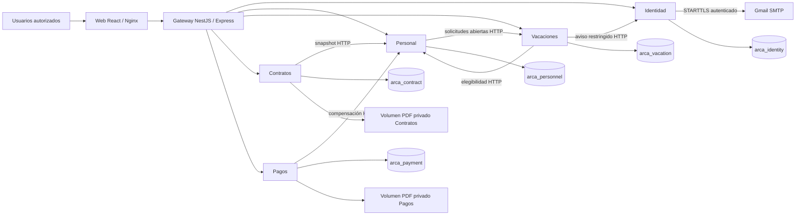

# ARCA RH: contexto y contenedores

El sistema atiende a Administración de RR. HH., Operación de RR. HH., Aprobación de vacaciones, Finanzas y Directorio. El Core externo no está integrado: no existe contrato técnico ni credencial para hacerlo. Gmail es una dependencia externa real para correo transaccional; los pagos manuales o simulados no realizan transferencias bancarias.

Las cinco bases residen en una única instancia PostgreSQL de Compose. Cada dominio tiene usuario SQL, esquema Prisma, cliente generado y migraciones propios. Las referencias entre dominios son UUID lógicos; no existen claves foráneas ni consultas SQL entre sus bases. El código compartido contiene infraestructura HTTP, firmas y generación documental, no entidades Prisma ni repositorios de negocio.

El navegador mantiene una sesión opaca en cookie HttpOnly/SameSite; el Gateway consulta su vigencia en Identidad antes de atender peticiones privadas. El Gateway firma una aserción Ed25519 de corta duración con audiencia específica. Los servicios reciben solo la clave pública y verifican rol, permiso explícito y ámbito del recurso. Las llamadas internas de dominios tienen credenciales individuales y un conjunto de emisores permitido por endpoint.

La red de Compose mantiene privados PostgreSQL y los cinco dominios. Web y Gateway publican puertos de loopback para el entorno local. `compose.dev.yaml` publica PostgreSQL en loopback solo para herramientas de desarrollo; no forma parte de la exposición canónica. `compose.tls.yaml` añade HTTPS local con un certificado temporal, sin modificar el almacén de confianza del equipo.

Los procesos de aplicación se ejecutan sin root y con sistema de archivos de solo lectura, excepto volúmenes documentales y `/tmp`. Identidad es el único dominio que recibe credenciales SMTP y la clave de cifrado de su outbox. Los contadores ejecutivos se consultan por API y no exponen snapshots individuales a Directorio.

El diagrama describe el código y la configuración existentes. La evidencia de build, arranque, aislamiento y recuperación se registra por separado en `docs/infra-operacion.md` y `docs/ESTADO.md`; un diagrama no acredita que esos ensayos hayan pasado.
